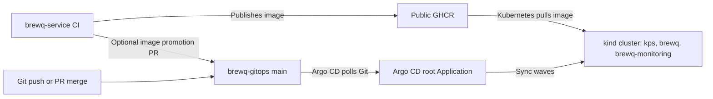

# brewq-gitops

Argo CD installs and reconciles Brewq and its observability stack on the
local kind cluster. This repo holds the environment values, failure drills
and incident template.



## The four-repo series

1. [brewq-service](https://github.com/Mythicc123/brewq-service) builds the Go
   service and load generator. Release `v0.1.0` publishes image tag `0.1.0`.
2. [brewq-k8s](https://github.com/Mythicc123/brewq-k8s) creates the kind
   cluster and installs Traefik, the shared Gateway and metrics-server.
   It owns the application Helm chart.
3. [brewq-observability](https://github.com/Mythicc123/brewq-observability)
   owns the Prometheus stack values, alert rules, dashboards and load generator
   deployment.
4. [brewq-gitops](https://github.com/Mythicc123/brewq-gitops) bootstraps
   Argo CD. Its root Application deploys the three child Applications.

## Prerequisites

Docker Desktop must be running. Install kind, kubectl, Helm, Git and make.
The bootstrap also uses OpenSSL. Status inspection uses curl and jq, and
the drill helper needs Mike Farah's yq v4. For local lint, install
kubeconform and actionlint. ShellCheck runs when installed.

The GitOps Applications read the public GitHub repositories on `main`.
Make sure the sources and public `0.1.0` image exist before bootstrap.
Builds and image pulls need internet access.

## Quick start

For the GitOps path, run the commands below from the directory containing
the project checkouts. Start with a fresh cluster so Argo CD can own the
Brewq and monitoring releases.

```bash
make -C brewq-k8s up
make -C brewq-gitops bootstrap
make -C brewq-gitops status
make -C brewq-gitops urls
make -C brewq-gitops password
```

The Makefile uses the `kind-brewq` context from your `KUBECONFIG`. You can
pass `KUBE_CONTEXT` to the Makefile if your local context has another name.

Log in to [Argo CD](http://argocd.localtest.me) as `admin`. Bootstrap
starts reconciliation in the background. Use `make status` to wait for
`root`, `kube-prometheus-stack`, `brewq` and `brewq-monitoring` to show
Synced and Healthy, then verify the service.

```bash
make -C brewq-k8s smoke
make -C brewq-k8s test
```

Grafana also uses the user `admin`. Read its generated password locally,
then give Prometheus time to collect samples for the dashboards.

```bash
kubectl --context kind-brewq -n monitoring get secret grafana-admin \
  -o 'go-template={{(index .data "admin-password") | base64decode}}{{"\n"}}'
```

Check that the Brewq scrape targets are up in Prometheus and run
`make -C brewq-gitops alerts`. Watchdog is the expected firing alert at
the healthy baseline. Run `make -C brewq-k8s down` when you finish.

For the manual path, use a fresh cluster from repo 2 and install the
charts using repos 2 and 3.

```bash
make -C brewq-k8s up
make -C brewq-k8s deploy
make -C brewq-observability install
```

Choose one path per cluster so each chart has a single owner.
`make uninstall` in this repo prunes the child Applications and removes
the Argo CD release. It preserves the Grafana Secret, the Argo CD CRDs
and the platform.

## Design and trade-offs

- The root Application creates kube-prometheus-stack first. The stack
  installs the Prometheus Operator CRDs. The monitoring Application also
  retries syncs if CRD discovery lags. The KPS chart is pinned to `93.10.1`.
- Each child combines its chart source with values from this repo. KPS also
  reads the shared values in repo 3, with local values applied last.
  Automated prune removes deleted Git resources and self-heal corrects
  changes to declared fields. While autoscaling is enabled, the HPA owns replicas.
- Traefik, the Gateway and metrics-server are installed before Argo CD.
  The local HTTP endpoints are suitable for a local demo. Keep them on
  the development machine.
- The optional service CI promotion job opens a PR that sets `image.tag`
  in `envs/local/brewq-values.yaml` to a `sha-<short sha>` image. It uses
  the service repo's optional `GITOPS_TOKEN`, a fine-grained token with
  contents and pull-request write access to this repo. Merging the PR
  triggers reconciliation through the same path as a drill change.

## Drills

| Drill | Expected signal | Run |
| --- | --- | --- |
| [Bad release](drills/01-bad-release.md) | `BrewqAvailabilityBurnFast` | `make drill-01` |
| [Slow release](drills/02-slow-release.md) | `BrewqLatencyBurnFast` | `make drill-02` |
| [Startup crash](drills/03-crashloop.md) | `BrewqPodCrashLooping` | `make drill-03` |
| [Memory leak](drills/04-memory-leak.md) | `BrewqPodOOMKilled` | `make drill-04` |
| [Node drain](drills/05-node-drain.md) | No SLO alert expected | Follow the runbook |
| [Deployment drift](drills/06-drift.md) | Argo CD restores the declared latency setting | Follow the runbook |

The [drill guide](drills/README.md) explains baseline checks and expected
alert timing. The helper for drills 01–04 commits and pushes to `main`
after confirmation. `make rollback` reverts and pushes the latest drill
commit. Both commands require write access to `origin/main`.

Write the first postmortem after drill 01. Start with the
[incident template](incidents/TEMPLATE.md), then use the
[incident guide](incidents/README.md) to record measured budget spent and
the recovery timeline in Sydney time.

## Cost: $0

The cluster runs locally. Public GHCR and standard GitHub-hosted runners
for the public repository cover images and CI. Alerts appear locally and
no notification account is needed. Run `make down` in brewq-k8s to delete
the cluster and its data.

## Next steps

Use the drill measurements to refine the runbooks and capture the first
real incident.
